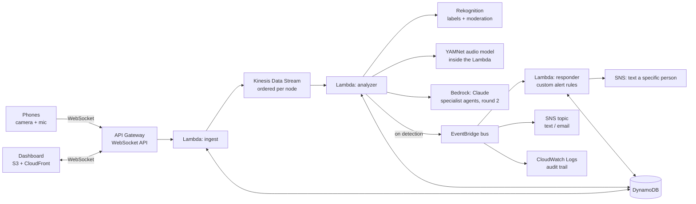

# Safety Sentinel

Phones become sensor nodes. Each one streams camera frames and microphone clips to AWS, where four
specialist AI agents score the danger (gunfire, weapons, physical altercations, fire and other hazards),
compare notes with each other and with nearby nodes, and trigger alerts when a zone becomes dangerous.

Open the dashboard, scan the QR code with a phone, allow camera and microphone, and that phone is a node.

## Architecture



| Judges' note | Where it lives |
| --- | --- |
| One agent per data point (gunshot, rifle, altercation, others) | `src/core/agents.ts` — `gunshot`, `weapon` (rifle / handgun / blade), `altercation`, `hazard` |
| Agents score threats based on each other's opinions | Round 2 in `src/core/agents.ts` (`deliberate`, fixed rules, always runs) and `src/core/llm.ts` (one Claude call per agent on Bedrock, each shown the others' opinions) |
| A central script holding the action algorithm (dial police, call a specific person, custom alerts) | `src/core/actions.ts`, run by the responder Lambda; rules are edited on the dashboard |
| Nodes communicate; critical positions get higher scoring capability | `src/core/fusion.ts` (`zoneScore`: position weights 1.0 / 0.8 / 0.6, corroboration across nodes) and the "heightened watch" directive nodes send their zone peers (`src/core/pipeline.ts`) |
| API Gateway WebSocket → Kinesis → EventBridge → Lambda / SNS, Rekognition | `infra/sentinel-stack.ts` |
| Agent Toolkit for AWS | A toolkit for coding agents, not a runtime service. Use it to deploy and operate this stack from Claude Code (see Deploy) |

All tunable numbers (levels, weights, half-lives, cooldowns) are in `src/core/config.ts`.

## How the score is computed

1. **Perception.** Rekognition labels each frame (`DetectLabels`, `DetectModerationLabels`). YAMNet
   classifies each 1.3 s audio clip into 521 sound classes.
2. **Round 1.** Each agent scores only its own evidence, 0 to 1. Evidence is remembered and halves every 10 s.
3. **Round 2.** Each agent hears the others and the strongest peer node in its zone, and revises. A visible
   rifle raises the gunshot agent's belief that a bang was a shot. An agent with no evidence of its own can
   only be nudged. When Bedrock is reachable, Claude revises each opinion with a written reason, limited
   to ±0.3 around round 1 so a model error cannot invent or erase a threat. Alerts never wait for the LLM.
4. **Node score** = noisy-OR of (agent score × severity). Severity: gunshot 1.0, weapon 0.95, altercation 0.75, hazard 0.7.
5. **Zone score** = noisy-OR over nodes of (node score × position weight × freshness).
   A peripheral node at 80% alone gives ELEVATED; a critical node at 80% gives CRITICAL; two peripheral nodes agreeing give HIGH.
6. **Levels.** ELEVATED ≥ 25%, HIGH ≥ 50%, CRITICAL ≥ 75%. A zone at HIGH or above publishes one
   `ThreatDetected` event (45 s cooldown unless the level rises).

## Run locally

```bash
npm install
```

```bash
npm run dev
```

Open http://localhost:8080 for the dashboard and http://localhost:8080/node.html in another tab to act as a node.
Local mode runs the real pipeline and the real audio model with in-memory stand-ins for DynamoDB, Kinesis,
EventBridge and SNS. Rekognition and Bedrock are not called locally, so use the dashboard's drill buttons for
visual threats. Phones cannot join a local server, because browsers only allow camera access over HTTPS.

```bash
npm test
```

## Deploy to AWS

You need an AWS account, credentials in your shell, and Node 22. Deploy from macOS, Linux or WSL.

```bash
npm install
```

```bash
npx cdk bootstrap
```

```bash
npm run deploy -- -c alertEmail=you@example.com -c joinCode=pick-a-code
```

The command prints `DashboardUrl` and `PhoneNodeUrl`. Options (all `-c key=value`):

- `alertEmail` — subscribes that address to the SNS alerts topic (confirm the email AWS sends).
- `joinCode` — phones and dashboards must present it. Set one: the WebSocket endpoint is public, and every frame costs money.
- `bedrockModelId` — default `anthropic.claude-opus-5-5`. For faster, cheaper agent replies use `anthropic.claude-haiku-5-5`. Pass an empty value to run rule-based agents only.

Before the demo:

- **Bedrock model access.** Enable the Claude model in the Bedrock console for your region. If it is not
  enabled the system still works; the dashboard shows "LLM unavailable; rule-based opinions used".
- **Text messages.** New AWS accounts are in the SNS SMS sandbox and can only text verified numbers.
  Verify your phone under SNS → Text messaging → Sandbox destination phone numbers.
- **Agent Toolkit for AWS (optional).** Run `aws configure agent-toolkit` (AWS CLI 2.35+) and install the
  `aws-core` plugin in Claude Code to deploy, tail logs and debug this stack from the agent.

Tear everything down with `npm run destroy`.

## Demo script

1. Open the dashboard on a laptop. Press **Add a phone as a sensor** and scan the QR code with two or three phones.
   Name one "Entrance" and mark it Critical; mark another Peripheral.
2. Play a gunshot clip from a speaker near a phone. Its gunshot agent rises, the zone goes HIGH or CRITICAL,
   the other phones show "Heightened watch", and an incident appears with the actions taken.
3. Hold a picture of a rifle up to a camera to exercise the weapon agent through Rekognition.
4. Select a node and use the drill buttons to show cases you cannot stage (active shooter, fire, fight).
   "Fireworks" shows a look-alike that stays below the alert threshold. Drill alerts are marked `[DRILL]`.
5. Add a custom alert that texts your own phone at HIGH, then repeat step 2.

## Limits you should know

- **"Dial police" is simulated.** It records the packet a dispatch integration would receive and never
  places a call. Real emergency dispatch needs a certified integration.
- **Detection quality.** YAMNet is a general sound classifier, not a forensic gunshot detector. On the
  recordings tried here, three of five distant outdoor gunshots scored 100% on the gunshot agent and two
  scored 33% and 44%; clapping, knocking and a siren scored 0%; one breaking-glass clip scored 61%.
  Expect false alarms from loud bangs.
- **Privacy.** Frames and clips are analysed and discarded; only labels, scores and the latest thumbnail
  shown on the dashboard are kept (DynamoDB items expire within hours). Tell people before pointing phones at them.
- **Cost while running.** Rekognition is the main cost: two calls per frame, one frame every 3 s per phone
  (every 1 s on heightened watch), roughly $2.50 per phone-hour at list price. Destroy the stack after the demo.
- **Phones.** The page must stay open and in the foreground; mobile browsers stop the camera in the background.
